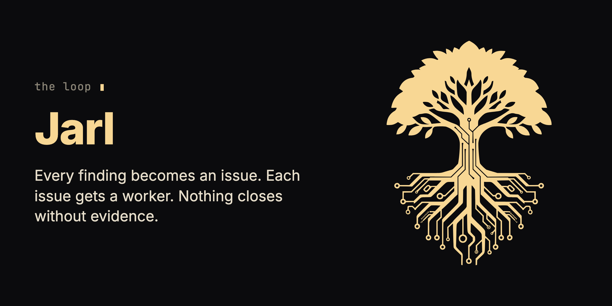

<p align="center"></p>

# Jarl

**Your feature branch has more issues than one agent can hold in its head, so it fixes one, forgets two, and loses the third in the diff.** Jarl makes the agent direct a crew instead of working alone.

On a feature branch, the agent files everything it sees as an issue, gives each issue a worker in its own worktree, and closes nothing without recorded evidence and a fresh reviewer's approval.

## What you install

In Claude Code:

```
/plugin marketplace add krzysztofdudek/JarlSkill
/plugin install jarl@jarl-marketplace
```

Then run `/reload-plugins` or restart Claude Code. Needs Node.js 22 or newer on your `PATH`; no config, no API key.

| Piece | Where it lands | What it does | When it acts |
|---|---|---|---|
| The Jarl skill, `/jarl` | your Claude Code plugins | Makes the agent the jarl of the branch: it files, schedules, raises workers, has them reviewed and merged. | When you run `/jarl <goal>`, or a session starts in a checkout that already has `.jarl/`. |
| The `jarl` MCP server | the plugin | Every command of the tool as an MCP tool (`jarl_resume`, `jarl_status`, `jarl_new` and the rest), the writing ones included. | Started with the session. |
| `.jarl/` | root of your main checkout; by default ignored by git through its own `.jarl/.gitignore` | The goal, the issues, the rulings, the questions to you and the log of every move. | From the first `/jarl` until the loop closes. |
| Worker branches and worktrees | your local git | One per issue, or per package of small neighbouring issues. | While the issue is in progress. |
| Merge commits | your feature branch | The merger merges each approved branch with a commit that names the issue, then runs the check on the result. | After a fresh reviewer approves. |
| Entries in Yggdrasil's logs | `.yggdrasil/`, only when the repository has a graph and a working `yg` | The rulings about a whole type of code that you ratified at close, written with `yg log add`. | At close, after your yes. |

- **Never touches:** it never merges into `main` and never pushes; merging and pushing wait for your word. By default the loop leaves no trace in the branch's history.
- **Needs:** Node.js 22 or newer and git. Nothing else from the family.
- **Costs:** no key and no service of its own. Every worker, reviewer and merger is an agent run on your account.
- **In the agent's context:** the skill's description always; the skill body and the references it links when the loop runs; the MCP tool list.

<details>
<summary>Other agents: GitHub Copilot CLI, Cursor, a plain skill folder</summary>

GitHub Copilot CLI:

```
copilot plugin marketplace add krzysztofdudek/JarlSkill
copilot plugin install jarl@jarl-marketplace
```

Cursor:

```
git clone https://github.com/krzysztofdudek/JarlSkill.git
ln -s "$(pwd)/JarlSkill" ~/.cursor/plugins/local/jarl
```

Then **Developer: Reload Window**.

A plain skill folder: copy the whole [`skills/jarl/`](skills/jarl/) directory, `references/` included, to `~/.claude/skills/jarl/` (user level) or `.claude/skills/jarl/` (project level), or wherever your agent reads skills. To use the MCP tools with a copied folder in Claude Code: `claude mcp add jarl -- node /absolute/path/to/skills/jarl/scripts/jarl-mcp.mjs`. Without them the skill uses the command line.

</details>

## What changes on the first day

- Everything anybody sees becomes an issue before anything is touched, so there are no fixes on the side.
- Issues that touch the same files run one after another; the rest run in parallel, each in its own worktree.
- A worker's report counts as a claim until a fresh reviewer reads the diff and checks the test was red before the change and green after.
- The agent asks you when a protection would weaken, the goal would change, or work reaches outside the session.
- The next session runs `resume` and picks up from the files, not from memory.

## Start

1. On a feature branch, run `/jarl make the export command handle every fixture in tests/fixtures`.

   You see: the jarl writes `.jarl/goal.md`, reads the fixtures and files what it finds as numbered issues, each with a checkable acceptance line.

2. Let it run.

   You see: issues that touch the same parser queued one after another, the others each given a worker in its own worktree, and each approved branch merged into your feature branch with a commit naming the issue.

3. When nothing is open, it closes the loop.

   You see: the changelog carries every user-visible change, the suite is green on the tip, and `.jarl/` is deleted. Merging to `main` and pushing wait for you.

To keep the loop in git instead, open it with `init "<goal>" --committed` (it travels with the branch) or `--permanent` (the repository keeps it as a record).

## What it does not do

- It does not enforce architecture or hold a charter; that is [Horde](https://github.com/krzysztofdudek/Horde), whose missions run on this same loop.
- It ships no machine gate of its own: where your repository has a check, name it with a `Check:` line in `goal.md` and the check decides what lands.
- Without a `Check:` line the loop lands on the reviewers' testimony alone, and `status` and `report` say so at the top.
- It records and displays; it never blocks code from landing.
- By default the loop lives only in the checkout that opened it; another clone does not see it.

## Remove it

In Claude Code:

```
claude plugin uninstall jarl@jarl-marketplace
claude plugin marketplace remove jarl-marketplace
```

On Copilot CLI, `copilot plugin uninstall jarl@jarl-marketplace`. On Cursor, delete the link in `~/.cursor/plugins/local/jarl`.

A closed loop already removed `.jarl/`. For an open one, delete `.jarl/` and the worker branches you no longer want. A committed or permanent loop is removed by a commit that deletes `.jarl/`.

## Questions

**Can the issues live in one repository while the code is in another?** Yes: name the other repository when you file an issue (`new "<title>" --repo <name>`), and the worker, the reviewer and the merger work there on its own feature branch.

**Can a research report become issues?** Yes: `import <findings.json>` files one issue per finding, and a second run files nothing twice.

**Can another tool read the loop?** `skills/jarl/scripts/record.mjs` is the one stable surface to vendor, under the contract `jarl-record/1` ([the record as a library](skills/jarl/references/composers.md#the-record-as-a-library)).

## Where it fits

Jarl is the loop of the family, and it works alone: it touches Yggdrasil only to write the rulings you ratified into its logs, and only when a graph and `yg` are there.

Read more: [The skill](skills/jarl/SKILL.md) · [The record](skills/jarl/references/record.md#the-files-of-the-loop) · [Commands and views](skills/jarl/references/commands.md#views-for-dashboards) · [What Jarl will not grow](skills/jarl/references/composers.md#what-jarl-will-not-grow) · [Changelog](CHANGELOG.md) · [Report a problem](https://github.com/krzysztofdudek/JarlSkill/issues)

## The Yggdrasil family

**Jarl** is the loop. **[Yggdrasil](https://github.com/krzysztofdudek/Yggdrasil)** is the law. **[Grain](https://github.com/krzysztofdudek/Grain)** is the survey. **[Horde](https://github.com/krzysztofdudek/Horde)** plans the mission onto the law before anyone writes, lands every change through a gate no agent can argue with, and turns what the mission learned into law. It runs on Jarl's loop, with Grain in the architect's hands. Those four are the core, and they ship under one version number, Jarl on it from 6.1.0: one set of tools built and tested against each other. Yggdrasil, Grain and Jarl each work alone; Horde is the one built on the other three. Where a repository has a check, the check decides what lands, in a Horde mission and in a Jarl loop alike: a fresh reviewer can only stop a change, never make a failing check pass, and its word is recorded as testimony. A Jarl loop in a repository with no check lands on testimony alone, and says so. Law that stays inside one component is raised freely by the agent working it. Law or decisions that reach a whole type of code are shared vocabulary: the agent proposes them and they run as advice at once, and the client, the one person the whole system answers to, admits them in one batch when the work closes. Only the client lowers or vetoes law. The core's shared machine contracts are registered on [one page](https://krzysztofdudek.github.io/Yggdrasil/family-contracts).

Start at the step where it hurts.

| Where it hurts | Start with |
|---|---|
| More issues than one agent can hold in its head | **Jarl** |
| The agent keeps breaking what was agreed | **Yggdrasil** |
| Nobody knows what was agreed | **Grain**, which earns its keep the moment you are about to write law |
| A task too big for one head to plan up front, in a repository that already has law | **Horde** |

| Core | What it holds |
|---|---|
| **Jarl** (this one) | The loop. Everything seen becomes an issue, each issue gets one worker in its own worktree, nothing closes without evidence and a review, and no code closes without a fresh reviewer's word. Rulings keep their history, and a ruling about a whole type of code goes to the client in one batch when the loop closes. |
| **[Yggdrasil](https://github.com/krzysztofdudek/Yggdrasil)** | The law. The architecture graph, the rules over it and the log of why, checked before the agent moves on and re-proved in CI without a key. A rule that reaches a whole type runs as advice until the client ratifies it. |
| **[Grain](https://github.com/krzysztofdudek/Grain)** | The survey. Mines a repository's own code and history into a first graph: components, dependencies, and the rules the code already keeps, each with the count of places that break it today; Yggdrasil accepts it with one command. It measures and never blocks. |
| **[Horde](https://github.com/krzysztofdudek/Horde)** | The mission on the law. A one-shot architect plans the whole mission onto the graph once, measuring with Grain; a worker per ticket in its own worktree; every change lands through a nine-item gate; what the mission learned becomes law. Its record is a Jarl loop. The client orders the mission and is the only one who can lower or veto a rule. |

Three add-ons attach to the agent rather than to the graph; each works alone, depends on nothing in the family and keeps its own version. Horde doesn't assume any of them is installed, since it carries its own minimum discipline in each role's law. It uses Ratatoskr, Urd and Researcher when they are, one sentence per row below.

| Add-on | Stage | What it makes the agent prove | In Horde's loop |
|---|---|---|---|
| **[Ratatoskr](https://github.com/krzysztofdudek/RatatoskrSkill)** | request → intent | Keeps the agent talking to you in plain words, not code, so you can follow what it's doing. | Keeps the client's plain-language registry open at both ends of a mission. |
| **[Urd](https://github.com/krzysztofdudek/UrdSkill)** | intent → code | When the spec is ambiguous, it consults the source of truth and asks, it doesn't guess. | The stop a worker hits before it guesses. |
| **[Researcher](https://github.com/krzysztofdudek/ResearcherSkill)** | code → measured result | Point it at a metric and it runs experiments, hypotheses kept and discarded. | Runs the retrospective's measurement. |

## License

MIT. Made by [Krzysztof Dudek](https://github.com/krzysztofdudek).

---

<div align="center">
  
</div>
